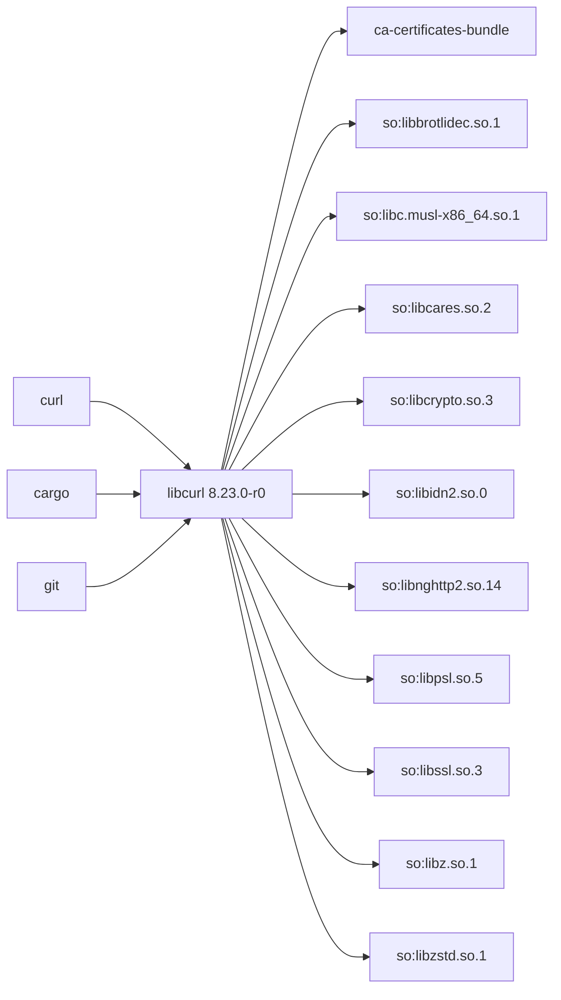
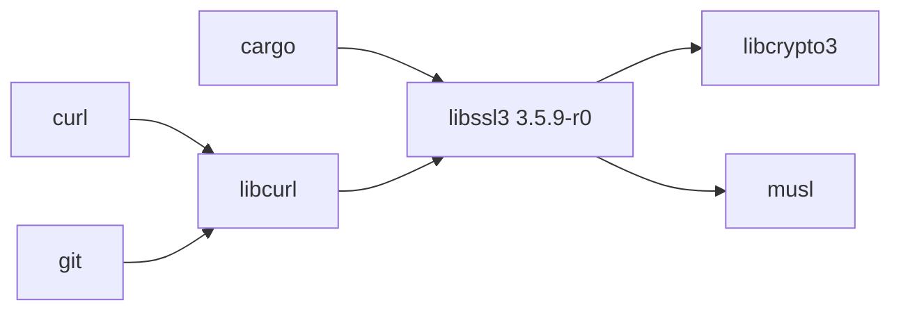
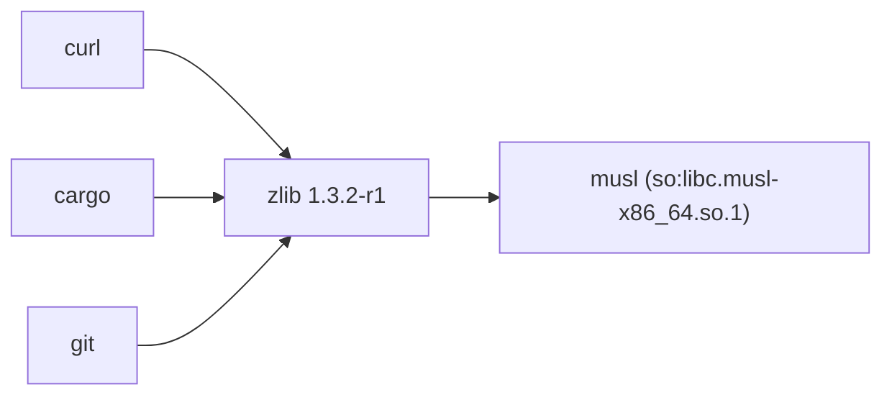

# Практическая работа №2 — вариант №4

**Дисциплина:** Конфигурационное управление  
**Тема:** инструмент построения и визуализации графа зависимостей пакетов Alpine Linux (`apk`)  
**Язык:** C# / .NET 9  
**Репозиторий для реальных примеров:** [Alpine v3.24 / main / x86_64](https://dl-cdn.alpinelinux.org/alpine/v3.24/main/x86_64)

## 1. Назначение

Приложение читает сведения о пакетах из репозитория Alpine Linux либо из локального JSON-файла для тестирования, строит ориентированный граф транзитивных зависимостей и сохраняет визуализацию в D2 и SVG.

Зависимость изображается направленным ребром `пакет -> зависимость`. Для построения графа используется **рекурсивный DFS**. Повторное посещение активного узла фиксирует цикл и останавливает дальнейший спуск по этому ребру.

## 2. Соответствие варианту №4

| Требование | Реализация |
|---|---|
| Параметры задаются JSON-файлом | `AppConfig` и `ConfigLoader` |
| Имя пакета, репозиторий/тестовый файл, режим теста, версия | `examples/config-*.json` |
| Имя SVG, максимальная глубина, фильтр | `outputFileName`, `maxDepth`, `filterSubstring` |
| Вывод параметров ключ–значение | Выполняется при запуске |
| Формат пакетов Alpine Linux | Разбор `APKINDEX.tar.gz` и записей `APKINDEX` |
| Запрет на менеджеры пакетов и сторонние библиотеки при получении данных | Индекс скачивается через `HttpClient`, распаковывается средствами .NET и разбирается собственным парсером |
| Транзитивные зависимости, рекурсивный DFS | `DependencyGraphBuilder` |
| Ограничение глубины и фильтрация | `maxDepth` и `filterSubstring` |
| Циклические зависимости | Активный стек DFS и список `CycleEdges` |
| Тестовый репозиторий с именами A–Z | `JsonTestRepository` и `examples/test-repository.json` |
| Обратные зависимости | `ReverseDependencyFinder`, включается параметром `showReverseDependencies` |
| Диаграмма D2 и изображение SVG | `D2Renderer` и `SvgRenderer` |

Для исключения конфликта имён все C# пространства имён начинаются с `DependencyGraphApp` (например, `DependencyGraphApp.Models`). Имя класса модели графа — `DependencyGraph`.

## 3. Структура проекта

```text
config_upr_pr_2/
├── Variant4DependencyGraph.sln
├── README.md
├── .gitignore
├── run.sh / run.bat
├── test.sh / test.bat
├── artifacts/
├── src/
│   └── DependencyGraph/
│       ├── DependencyGraph.csproj
│       ├── Program.cs
│       ├── Configuration/
│       ├── Models/
│       ├── Repositories/
│       ├── Services/
│       └── Visualization/
├── tests/
│   └── DependencyGraph.Tests/
└── examples/
    ├── test-repository.json
    ├── config-a.json
    ├── config-c.json
    ├── config-h.json
    ├── config-filter.json
    ├── config-curl.json
    ├── config-libcurl.json
    ├── config-libssl3.json
    └── config-zlib.json
```

`bin/`, `obj/`, IDE-настройки и автоматически сгенерированные диаграммы не хранятся в Git. Диаграммы создаются при запуске.

## 4. Конфигурация

Пример `examples/config-a.json` для тестового режима:

```json
{
  "packageName": "A",
  "repositoryUrl": "",
  "useTestRepository": true,
  "testRepositoryPath": "test-repository.json",
  "version": "1.0",
  "outputFileName": "artifacts/graph-a.svg",
  "maxDepth": 10,
  "filterSubstring": "",
  "showReverseDependencies": true
}
```

| Поле | Тип | Описание / проверка |
|---|---|---|
| `packageName` | string | Обязательное имя анализируемого пакета |
| `repositoryUrl` | string | Абсолютный HTTP(S) URL каталога репозитория Alpine. Не требуется в тестовом режиме. Можно указать URL непосредственно до `APKINDEX.tar.gz` |
| `useTestRepository` | boolean | `true` — читать JSON-файл, `false` — скачивать APKINDEX |
| `testRepositoryPath` | string | Путь до JSON тестового репозитория. Относительный путь считается от каталога файла конфигурации |
| `version` | string | Обязательная точная версия корневого пакета |
| `outputFileName` | string | Путь результирующего SVG; расширение должно быть `.svg` |
| `maxDepth` | integer | Максимальная глубина, целое число от 0. Корень имеет глубину 0. Ограничение применяется к прямому и обратному обходам |
| `filterSubstring` | string | Подстрока имени пакета, чувствительность к регистру не учитывается; пустая строка отключает фильтр |
| `showReverseDependencies` | boolean | `true` — вывести пакеты, прямо или транзитивно зависящие от выбранного пакета |

Путь `outputFileName` разрешается относительно текущего рабочего каталога. Каталог для результата создаётся автоматически. Для запуска с другим JSON передайте путь через `--config` или `-c`.

## 5. Формат тестового репозитория

Тестовый файл содержит массив `packages`. Каждый пакет имеет имя из заглавных латинских букв, версию и массив прямых зависимостей:

```json
{
  "packages": [
    { "name": "A", "version": "1.0", "dependencies": ["B", "C"] },
    { "name": "B", "version": "1.0", "dependencies": ["D"] },
    { "name": "C", "version": "1.0", "dependencies": [] }
  ]
}
```

Встроенный пример дополнительно содержит ветвление, общую зависимость и цикл `A -> B -> D -> A`. Это позволяет проверить дедупликацию узлов и обработку циклов.

## 6. Получение данных Alpine APK

В реальном режиме приложение формирует адрес `repositoryUrl/APKINDEX.tar.gz` (если в URL уже есть `APKINDEX.tar.gz`, повторно имя не добавляется), скачивает индекс стандартным `HttpClient`, распаковывает gzip/tar средствами .NET и разбирает текстовые поля `P`, `V`, `D` и `p`.

- `P` — имя пакета;
- `V` — версия;
- `D` — зависимости;
- `p` — предоставляемые capabilities (виртуальные возможности пакета).

Для зависимостей с префиксами `so:`, `cmd:` и `pc:` каталог пытается найти пакет-провайдер по полю `p`. Версия корневого пакета выбирается строго по `version`; для транзитивной зависимости выбирается самая новая доступная запись, удовлетворяющая простому ограничению версии в индексе.

**Ограничения упрощённой модели:** это анализатор индекса, а не полный решатель APK. Он не воспроизводит все правила выбора провайдера, приоритеты репозиториев/архитектур и разрешение системных путей вроде `/bin/sh`. Неизвестная зависимость сохраняется в графе как отдельный узел без раскрытия. Для корректного анализа задавайте URL конкретного каталога репозитория и архитектуры. Если нужна обратная зависимость для пакета из `community`, одного индекса `main` недостаточно: необходимо анализировать индекс соответствующего репозитория.

## 7. Сборка и запуск

Требуется установленный **.NET 9 SDK**. В решении нет внешних NuGet-зависимостей.

Из корня проекта:

```bash
dotnet restore Variant4DependencyGraph.sln
dotnet build Variant4DependencyGraph.sln --configuration Release

# Тестовый граф A
./run.sh examples/config-a.json

# Реальные пакеты из Alpine v3.24 main/x86_64
./run.sh examples/config-libcurl.json
./run.sh examples/config-libssl3.json
./run.sh examples/config-zlib.json
```

Windows PowerShell / CMD:

```bat
run.bat examples\config-libcurl.json
run.bat examples\config-libssl3.json
run.bat examples\config-zlib.json
```

То же самое напрямую через `dotnet run`:

```bash
dotnet run --project src/DependencyGraph/DependencyGraph.csproj -- --config examples/config-libcurl.json
```

При запуске без аргументов используется `examples/config-a.json`. Для реального режима необходим доступ к сети, чтобы скачать `APKINDEX.tar.gz`.

## 8. Тестирование

Тесты реализованы как автономный .NET console harness без xUnit/NUnit и без внешних пакетов:

```bash
./test.sh
# или
 dotnet run --project tests/DependencyGraph.Tests/DependencyGraph.Tests.csproj
```

Проверяются: транзитивный DFS и цикл, максимальная глубина, фильтр, обратные зависимости, разбор APKINDEX и генерация D2/SVG. Код возврата `0` означает успешное прохождение всех проверок.

## 9. Примеры для тестового репозитория

Запустите три конфигурации из корня проекта:

```bash
./run.sh examples/config-a.json
./run.sh examples/config-c.json
./run.sh examples/config-h.json
```

Ожидаемые графы по тестовым данным:

- **A:** прямые зависимости `B`, `C`; далее `D`, `E`, `F`, `G`; цикл `D -> A`.
- **C:** прямые зависимости `E`, `F`; транзитивная зависимость `G`.
- **H:** цепочка `H -> B -> D/E`, а далее `D -> A` и `E -> G`; узлы `A`, `B`, `D`, `E`, `G`.

Для проверки фильтра и ограничения глубины выполните:

```bash
./run.sh examples/config-filter.json
```

## 10. Три примера реальных пакетов Alpine v3.24

Все три конфигурации ниже используют один источник:

```text
https://dl-cdn.alpinelinux.org/alpine/v3.24/main/x86_64
```

Версии и список прямых зависимостей сверены со страницами официального каталога Alpine Packages **2 ноября 2026 года**. Репозиторий обновляется, поэтому перед демонстрацией рекомендуется повторно открыть страницу пакета и проверить версию.

### 10.1. `libcurl` — сложный граф библиотечных зависимостей

- Версия: `8.23.0-r0`.
- Прямых зависимостей в каталоге: 11.
- Примеры требований: `ca-certificates-bundle`, `so:libbrotlidec.so.1`, `so:libc.musl-x86_64.so.1`, `so:libcares.so.2`, `so:libcrypto.so.3`, `so:libidn2.so.0`, `so:libnghttp2.so.14`, `so:libpsl.so.5`, `so:libssl.so.3`, `so:libz.so.1`, `so:libzstd.so.1`.
- Примеры обратных зависимостей в `main`: `curl`, `cargo`, `git` (часть связей проходит через предоставляемые capabilities).
- На странице каталога для `libcurl` отображается `Required by (252)`; это общий список страницы пакета по ветке/архитектуре и он может включать `community`, а не только `main`.

Ниже — схема прямых требований и обратных зависимостей. Стрелка всегда направлена от потребителя к тому, от чего он зависит. Обозначения `so:` — виртуальные имена разделяемых библиотек, которые программа сопоставляет с `Provides` пакетов.



Конфигурация: [`examples/config-libcurl.json`](examples/config-libcurl.json).  
Каталог: [libcurl — v3.24/main/x86_64](https://pkgs.alpinelinux.org/package/v3.24/main/x86_64/libcurl).

### 10.2. `libssl3` — связь с криптографической библиотекой

- Версия: `3.5.9-r0`.
- Прямых требований в каталоге: 3: `libcrypto3`, `so:libc.musl-x86_64.so.1`, `so:libcrypto.so.3`.
- `so:libcrypto.so.3` предоставляется пакетом `libcrypto3`, поэтому при построении графа capability разрешается в пакет-провайдер.
- Примеры обратных зависимостей в `main`: `cargo` и `libcurl`; через `libcurl` обратный обход может также найти `curl` и `git`.
- На странице каталога отображается `Required by (486)` — это общий список пакета по ветке/архитектуре, не только `main`.

Схема после сопоставления capability с провайдером. `so:libcrypto.so.3` разрешается в пакет `libcrypto3`; повторное ребро к тому же пакету в графе не дублируется.



Конфигурация: [`examples/config-libssl3.json`](examples/config-libssl3.json).  
Каталог: [libssl3 — v3.24/main/x86_64](https://pkgs.alpinelinux.org/package/v3.24/main/x86_64/libssl3).

### 10.3. `zlib` — простой прямой граф и много обратных связей

- Версия: `1.3.2-r1`.
- Прямое требование: `so:libc.musl-x86_64.so.1`.
- Обратные зависимости в `main` включают `curl`, `cargo`, `git`, а также другие пакеты, использующие `so:libz.so.1`.
- На странице каталога отображается `Required by (863)` — общий список по ветке/архитектуре, он может включать `community`.

Схема прямой зависимости и примеры обратных рёбер:



Конфигурация: [`examples/config-zlib.json`](examples/config-zlib.json).  
Каталог: [zlib — v3.24/main/x86_64](https://pkgs.alpinelinux.org/package/v3.24/main/x86_64/zlib).

### Как воспроизвести реальные примеры

Из корня проекта запустите:

```bash
./run.sh examples/config-libcurl.json
./run.sh examples/config-libssl3.json
./run.sh examples/config-zlib.json
```

Для каждого пакета программа скачает APKINDEX выбранного репозитория, построит граф в пределах `maxDepth`, сохранит D2 и SVG и выведет обратные зависимости, если `showReverseDependencies` равно `true`. Результаты появятся в `artifacts/`:

```text
artifacts/
├── graph-libcurl.d2
├── graph-libcurl.svg
├── graph-libssl3.d2
├── graph-libssl3.svg
├── graph-zlib.d2
└── graph-zlib.svg
```

**Важно о сравнении обратных зависимостей:** счётчик `Required by` на сайте Alpine Packages показывает более широкий список пакетов для ветки и архитектуры; конфигурации программы выше скачивают только `main/x86_64`. Поэтому приложение покажет зависимости, которые присутствуют именно в `main`, и его число может быть меньше каталожного. Чтобы получить полный список из `main` и `community`, понадобилось бы расширить программу на одновременную загрузку нескольких APKINDEX; текущая реализация этого не делает.

## 11. Сравнение со штатным инструментом Alpine

Штатная команда `apk dot` формирует граф зависимостей в формате Graphviz DOT. Для сравнения в контейнере Alpine той же ветки и архитектуры можно выполнить:

```sh
apk update
apk add graphviz
apk dot libcurl > /work/libcurl-apk.dot
dot -Tsvg /work/libcurl-apk.dot -o /work/libcurl-apk.svg
```

Сравнивайте состав вершин и рёбер, прямые и транзитивные зависимости, обработку виртуальных зависимостей. D2/SVG, созданные проектом, и DOT/SVG, созданные `apk dot`, могут отличаться расположением блоков; это не означает, что сами связи различаются. При расхождении списков сначала проверьте, что используются одна ветка, одна архитектура и одна версия индекса. Проект читает только указанный APKINDEX и использует упрощённое разрешение providers, а штатный APK применяет собственные правила выбора провайдеров.

## 12. История коммитов по пяти этапам

История Git в этом проекте разделена на пять последовательных коммитов. Каждый коммит добавляет очередной этап, а пятый коммит содержит итоговый вариант программы — тот же исходный C#-код, который был в предоставленном проекте; дополнительные изменения внесены в README и примеры конфигураций.

```text
feat(config): add JSON configuration and validation
feat(repository): parse Alpine APKINDEX metadata
feat(graph): build transitive graph with recursive DFS
feat(reverse): calculate reverse dependencies
feat(visualization): export D2 and SVG diagrams
```

Проверить историю можно командой:

```bash
git log --oneline --reverse
```

Для сдачи репозиторий должен быть публичным, содержать `README.md`, `.gitignore`, `src/`, `tests/`, скрипты запуска и пять отдельных коммитов с сообщениями в стиле Conventional Commits.
